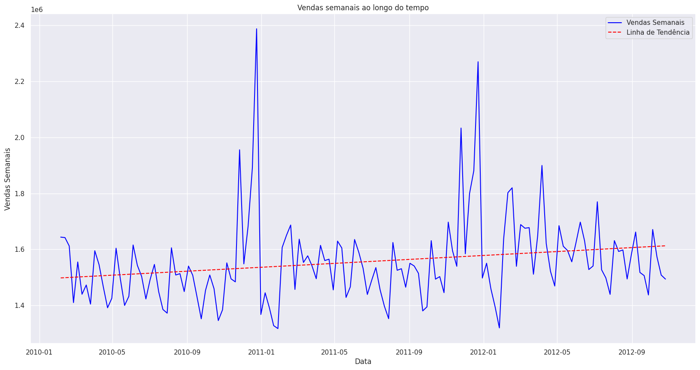
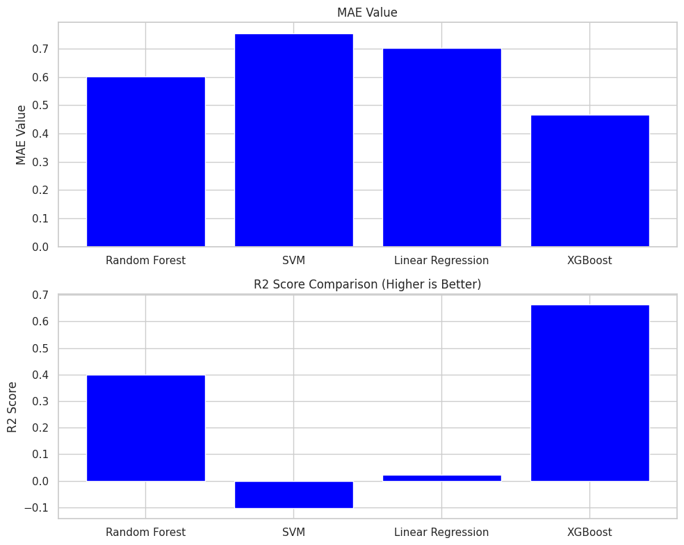

# Melhores Compras | Análise de Vendas e Machine Learning
### Python e Power BI

Projeto acadêmico de análise de vendas semanais com Python, comparação de modelos de regressão e apresentação dos resultados em Power BI. Desenvolvido pelo **Grupo 68**, em 2024, no PBL da fase 7 do 2º ano.

[Notebook](notebooks/modelagem_vendas.ipynb) · [Relatório original](reports/relatorio_grupo68.pdf) · [Dashboard Power BI](powerbi/dashboard_vendas.pbix) · [Notas metodológicas](docs/notas_metodologicas.md)

## Problema de negócio

Como analisar o comportamento das vendas semanais e comparar modelos capazes de estimá-las a partir das variáveis disponíveis?

O trabalho explora tendências, feriados e variáveis econômicas, compara algoritmos de regressão e apresenta os resultados em um relatório e em um dashboard. A publicação preserva os materiais acadêmicos originais; não representa um sistema de previsão em produção.

## Etapas do projeto

1. Leitura e preparação dos dados, incluindo conversão de datas e ajustes de escala.
2. Verificação de duplicidades e valores ausentes.
3. Análise exploratória, gráficos de dispersão e correlações.
4. Criação da variável de semana do ano.
5. Comparação entre Random Forest, SVR, Regressão Linear e XGBoost.
6. Avaliação por métricas de regressão, validação cruzada e configuração de hiperparâmetros.
7. Apresentação dos resultados com Power BI.

## Visualização dos estudos

### Evolução das vendas



### Comparação inicial dos modelos



As imagens foram extraídas das saídas salvas no notebook original, sem reexecução.

## Resultados registrados no notebook

| Modelo | R² no teste |
| --- | ---: |
| Regressão Linear | 0,02 |
| SVR | -0,10 |
| Random Forest | 0,40 |
| XGBoost inicial | 0,66 |
| XGBoost com hiperparâmetros configurados | 0,7215 |

Esses valores são **resultados históricos das saídas salvas**. A base tem 143 observações e a divisão usada no notebook é aleatória, com 80% para treino e 20% para teste. Eles não comprovam capacidade de prever semanas futuras.

O alvo foi padronizado antes da divisão: os erros apresentados no notebook não estão na unidade monetária original. Há também divergências entre o relatório e o notebook, detalhadas nas [notas metodológicas](docs/notas_metodologicas.md).

## Dados

O notebook lê um arquivo chamado **`sales.csv`**, que **não foi fornecido nesta publicação**. Para reexecutá-lo, obtenha a base original e coloque-a na pasta `notebooks/`.

| Coluna esperada | Descrição |
| --- | --- |
| `Date` | Data da observação semanal. |
| `Weekly_Sales` | Valor de vendas semanais; variável alvo. |
| `Holiday_Flag` | Indicador de feriado na semana. |
| `Temperature` | Temperatura registrada. |
| `Fuel_Price` | Preço de combustível, conforme a escala da base. |
| `CPI` | Índice econômico fornecido na base. |
| `Unemployment` | Indicador de desemprego, conforme a escala da base. |

As saídas salvas indicam dados entre fevereiro de 2010 e outubro de 2012. A origem e a licença da base não acompanham os arquivos recebidos; nenhum dataset foi substituído ou reconstruído.

## Como consultar e executar

### Notebook

É possível visualizar o notebook diretamente no GitHub, incluindo seus gráficos e resultados salvos.

Para execução local, use preferencialmente **Python 3.10**, versão observada no ambiente original. Na raiz do projeto:

```powershell
python -m venv .venv
.venv\Scripts\Activate.ps1
python -m pip install -r requirements.txt
cd notebooks
python -m jupyterlab .
```

Abra `modelagem_vendas.ipynb`, disponibilize `sales.csv` na mesma pasta e execute as células na ordem. O notebook mantém sua célula original de instalação de dependências.

As versões das seis bibliotecas principais foram recuperadas dos logs salvos. O ambiente completo não foi reconstruído nem testado, pois a base CSV está ausente.

### Power BI

Baixe [dashboard_vendas.pbix](powerbi/dashboard_vendas.pbix) e abra no Power BI Desktop. O arquivo contém as páginas **Home**, **Visão Geral** e **Insights**.

Para atualizar os dados, revise as fontes e os caminhos configurados no Power BI. O arquivo foi inspecionado estruturalmente; não foi aberto nem validado no Power BI Desktop durante a preparação desta publicação.

## Organização

| Caminho | Conteúdo |
| --- | --- |
| `notebooks/modelagem_vendas.ipynb` | Notebook original de análise e modelagem. |
| `powerbi/dashboard_vendas.pbix` | Dashboard original do Power BI. |
| `reports/relatorio_grupo68.pdf` | Relatório acadêmico original. |
| `assets/` | Gráficos extraídos do notebook para apresentar o projeto. |
| `docs/notas_metodologicas.md` | Limitações e divergências identificadas na documentação. |
| `requirements.txt` | Bibliotecas para preparar um ambiente de execução. |

## Possíveis evoluções

- Disponibilizar a base original, após confirmar sua licença de redistribuição.
- Separar treino e teste respeitando a ordem temporal.
- Ajustar os transformadores somente no treino, usando pipelines.
- Comparar os modelos com uma previsão ingênua e uma referência sazonal.
- Avaliar os erros na unidade original das vendas.
- Revisar o relatório e atualizar as fontes do Power BI.

## Contexto e autoria

Material acadêmico do **Grupo 68**, publicado no portfólio de Gabriel de Assis. A publicação organiza e documenta os arquivos recebidos, preservando o notebook, o relatório e o PBIX sem alterar seus bytes. Não foi adicionada uma licença de redistribuição aos materiais originais.
